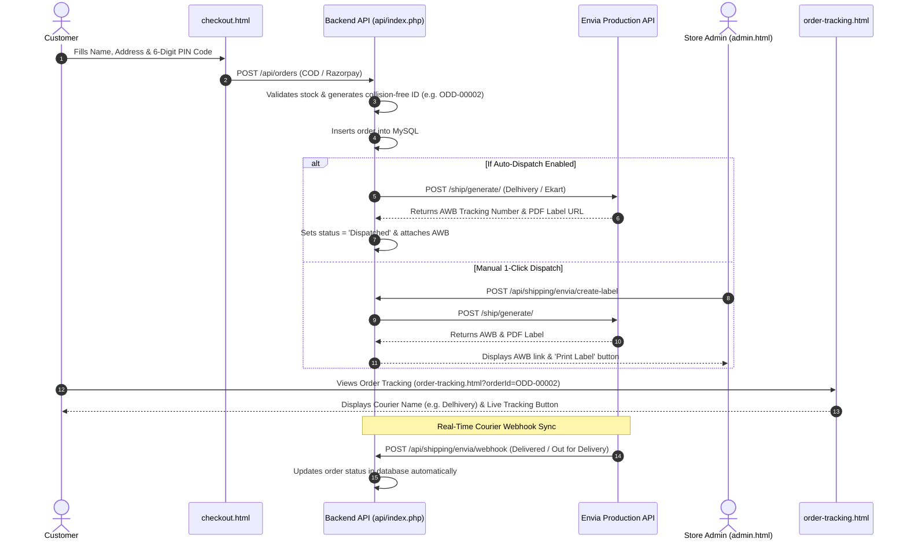

# ODD Perfumes — Envia Multi-Carrier Shipping Production Integration Guide

This guide details the complete architecture, API contracts, automated webhooks, and step-by-step production setup for Envia Multi-Carrier Shipping (`shipping.envia.com`) integrated into ODD Perfumes.

---

## 1. Architecture & End-to-End Workflow

The integration follows the official Envia E-Commerce Checkout & Fulfillment architecture:



---

## 2. API Endpoints Reference

All routes are implemented in [api/index.php](file:///D:/AYAN/odd-perfume/api/index.php) for Hostinger production and mirrored in [server.js](file:///D:/AYAN/odd-perfume/server.js) for local development.

### 2.1 Test Connection & Carrier Discovery
* **Endpoint:** `POST /api/shipping/envia/test`
* **Access:** Staff / Admin
* **Payload:** `{"apiKey": "...", "env": "live"}`
* **Upstream:** `GET https://queries.envia.com/carrier?country_code=IN`
* **Returns:** Connected Indian courier partners (Delhivery, Ekart, DTDC, Blue Dart).

### 2.2 Live Multi-Carrier Rate Estimation (Step 2 of Envia Docs)
* **Endpoint:** `POST /api/shipping/envia/rates`
* **Access:** Public / Checkout
* **Payload:**
```json
{
  "postalCode": "400710",
  "city": "Navi Mumbai",
  "totalAmount": 979
}
```
* **Upstream:** Parallel `POST https://api.envia.com/ship/rate/` for `delhivery` and `ekart`.
* **Returns:** Sorted rates by lowest cost:
```json
{
  "success": true,
  "count": 2,
  "rates": [
    {
      "carrier": "ekart",
      "carrierName": "Ekart",
      "service": "ground",
      "serviceName": "Ekart Surface",
      "totalPrice": 38.18,
      "currency": "INR",
      "estimate": "1-4 days"
    },
    {
      "carrier": "delhivery",
      "carrierName": "Delhivery",
      "service": "express",
      "serviceName": "Delhivery Air",
      "totalPrice": 49.72,
      "currency": "INR",
      "estimate": "1-2 days"
    }
  ]
}
```

### 2.3 Generate Shipping Label & Courier AWB (Step 3 of Envia Docs)
* **Endpoint:** `POST /api/shipping/envia/create-label`
* **Access:** Admin / Staff (`shipping` or `orders` role)
* **Payload:** `{"orderId": "ODD-00001"}`
* **Upstream:** `POST https://api.envia.com/ship/generate/`
* **Settings Sent to Envia:**
  * `printFormat`: `"PDF"`
  * `printSize`: `"STOCK_4X6"`
  * `service`: `"express"` (or `"ground"`)
  * `declaredValue`: Order total in INR
* **Database Updates:**
  * `courier_name = carrierName` (e.g. `Delhivery`)
  * `tracking_number = trackingNumber` (e.g. `140123456789`)
  * `tracking_url = trackUrl` (Official direct tracking link)
  * `label_url = labelUrl` (Printable thermal / standard PDF shipping label)
  * `status = "Dispatched"`

### 2.4 Automatic Real-Time Tracking Webhook (Step 4 of Envia Docs)
* **Endpoint:** `POST /api/shipping/envia/webhook`
* **Public URL:** `https://test.oddperfume.com/api/shipping/envia/webhook`
* **Status on Envia:** Registered under ID `#5203`
* **Trigger:** Courier scans parcel at transit hubs or delivers to customer door.
* **Payload Handled:**
```json
{
  "carrierName": "delhivery",
  "trackingNumber": "140123456789",
  "status": "Delivered"
}
```
* **Database Transitions:**
  * Status contains `deliver` -> Sets `status = 'Delivered'`, `payment_status = 'Paid'`, `delivered_at = NOW()`.
  * Status contains `out for delivery` -> Sets `status = 'Out for Delivery'`.
  * Status contains `transit` / `picked up` -> Sets `status = 'Dispatched'`.
  * Status contains `return` / `exception` -> Sets `status = 'Exception'`.

---

## 3. What to Implement Where (Files & Deployment Map)

To activate this entire workflow on your live site, upload these 4 modified files to Hostinger File Manager in their corresponding folders:

| File Path on Local | Target Location in Hostinger `public_html/` | Purpose |
| :--- | :--- | :--- |
| `api/index.php` | `api/index.php` | Order ID collision lock, Envia label creation, live rates, and tracking webhook |
| `api/config.php` | `api/config.php` | Production Envia API key and environment constants |
| `admin.html` | `admin.html` | Envia settings form, Auto-dispatch toggle, Webhook status card, and 1-click dispatch buttons |
| `assets/js/admin.js` | `assets/js/admin.js` | Webhook synchronization, unwrap error messages, and label rendering |
| `assets/js/tracking.js` | `assets/js/tracking.js` | Displays official carrier badge and live tracking link on customer order page |

---

## 4. Production Checklist on Envia (`shipping.envia.com`)

1. **Top-Up Wallet Balance**:
   * Navigate to `https://shipping.envia.com/home`.
   * Under Quick Actions, click **Top-Up Wallet**.
   * Add a balance (e.g. ₹200 to ₹500) via UPI or Card.
   * *Reason:* Envia charges real courier freight fees (e.g. ₹45.36 per Delhivery shipment). A balance of ₹0.00 blocks label creation with error `1170 Not Enough money`.
2. **Verify Billing**:
   * Complete the **Verify your billing information** step in Envia so your tax receipts and invoices generate properly.
3. **Verify Registered Webhook**:
   * We already executed the registration API:
     * Webhook ID: `#5203`
     * Type: `onShipmentStatusUpdate`
     * Target: `https://test.oddperfume.com/api/shipping/envia/webhook`
     * Active: `1`

---

## 5. Daily Fulfillment Operations

### Manual 1-Click Fulfillment
1. Open `https://test.oddperfume.com/admin.html` and click **ODD Orders**.
2. Click **Ship with Envia** on any new order.
3. The table immediately updates with:
   * Carrier Name (`DELHIVERY`)
   * AWB tracking number link
   * **Print Label** button (opens official PDF shipping sticker for the package).

### Automated Fulfillment (Hands-Free)
1. In Admin Portal -> **Shipping & Delivery**.
2. Check: `[x] Auto-book Envia courier shipment & generate AWB on new customer orders`.
3. Click **Save Envia Settings**.
4. Every time a customer places an order on `checkout.html`, the system books the courier and attaches the label automatically.
