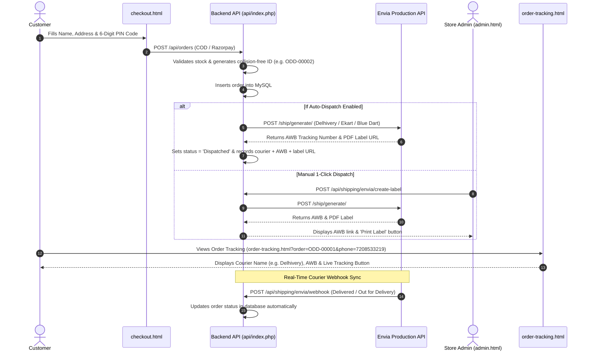

# ODD Perfumes — Envia Multi-Carrier Shipping Production Integration Guide

This guide details the complete architecture, API contracts, automated webhooks, audit findings, and step-by-step production deployment instructions for Envia Multi-Carrier Shipping (`shipping.envia.com`) integrated into ODD Perfumes (`test.oddperfume.com`).

---

## 1. Architecture & End-to-End Workflow

The integration follows the official Envia E-Commerce Checkout & Fulfillment architecture:



---

## 2. Issues Audited & Resolved

### Issue 1: "Ship with Envia" button remained visible after dispatch (Screenshot 7)
* **Root Cause:** In [api/index.php](file:///D:/AYAN/odd-perfume/api/index.php), `GET /api/orders` aliased columns as camelCase (`tracking_number as trackingNumber`, `courier_name as courier`, `label_url as labelUrl`, `tracking_url as trackingUrl`). However, in [assets/js/admin.js](file:///D:/AYAN/odd-perfume/assets/js/admin.js), line 728 evaluated `if (order.tracking_number)`. Because `order.tracking_number` was `undefined`, it branched to the fallback condition and kept re-rendering the orange `Ship with Envia` button instead of displaying the courier name badge, AWB tracking link, and printable label button.
* **Fix Applied:**
  1. Updated `GET /api/orders` in both [api/index.php](file:///D:/AYAN/odd-perfume/api/index.php) and [server.js](file:///D:/AYAN/odd-perfume/server.js) to return both camelCase and snake_case properties (`trackingNumber`, `tracking_number`, `courier`, `courier_name`, `labelUrl`, `label_url`, `trackingUrl`, `tracking_url`).
  2. Updated `renderOrdersTable()` in [assets/js/admin.js](file:///D:/AYAN/odd-perfume/assets/js/admin.js) to check `order.tracking_number || order.trackingNumber` and use safe fallbacks for courier, tracking URL, and label URL.

### Issue 2: Red Error Toast `SQLSTATE[42S22] Unknown column 'used_at'` (Screenshot 3)
* **Root Cause:** The database schema for table `coupon_usages` specifies column `created_at`, but the older coupon usages endpoint in `api/index.php` executed `SELECT ..., used_at as date FROM coupon_usages`. When loading the Launch Offer & Coupon Codes manager tab, MySQL threw a 1054 error.
* **Fix Applied:** In [api/index.php](file:///D:/AYAN/odd-perfume/api/index.php) and [server.js](file:///D:/AYAN/odd-perfume/server.js), updated the query to `SELECT ..., created_at as date FROM coupon_usages` and wrapped the database call in a defensive `try { ... } catch (Throwable $e) { $usages = []; }` block.

### Issue 3: Console ReferenceErrors `toggleEnviaKeyVisibility is not defined` (Screenshots 4 & 5)
* **Root Cause:** Inline `onclick` handlers in [admin.html](file:///D:/AYAN/odd-perfume/admin.html) were calling functions that were either bound after `DOMContentLoaded` or failed to execute due to cached scripts without version busting.
* **Fix Applied:**
  1. Forwarded global function references (`window.toggleEnviaKeyVisibility`, `window.saveEnviaSettings`, `window.testEnviaConnection`, `window.registerEnviaWebhook`, `window.shipWithEnvia`) at the very top of [assets/js/admin.js](file:///D:/AYAN/odd-perfume/assets/js/admin.js) before any execution can be interrupted.
  2. Added unobtrusive DOM event listeners in `DOMContentLoaded` for `#btn-toggle-envia-key`, `#btn-save-envia`, `#btn-test-envia`, and `#btn-register-webhook`.
  3. Bumped script cache-buster in [admin.html](file:///D:/AYAN/odd-perfume/admin.html) to `assets/js/admin.js?v=3.5`.

### Issue 4: Live Production vs. Sandbox Test Account & Wallet Balances (Screenshots 1 & 6)
* **Background:**
  * Envia separates environments:
    * **Live Production:** `shipping.envia.com` / `api.envia.com` (Your Company #897395, wallet balance ₹0.00).
    * **Sandbox Testing:** `shipping.test.envia.com` / `api-test.envia.com` (Your Company #883014, test wallet balance ₹93,698.54).
  * In live production, Envia charges real courier freight fees (e.g. ₹43.66 for Delhivery). If the live wallet balance is ₹0.00, Envia returns error 1170 (`Not Enough money`).
* **Fix Applied:**
  * In [api/index.php](file:///D:/AYAN/odd-perfume/api/index.php) and [server.js](file:///D:/AYAN/odd-perfume/server.js), added clear error parsing: when error 1170 occurs, the admin toast clearly instructs:
    `Insufficient Envia wallet balance (Not Enough money). Please recharge your Envia account balance at shipping.envia.com to generate courier labels.`
  * The Admin portal supports both modes:
    * To test without cost: Select `Sandbox / Testing` and use your Sandbox API token (from `shipping.test.envia.com` -> Settings -> Developers / API Keys) which draws from the ₹93,698.54 test balance.
    * For real customer orders: Select `Live Production`, keep your live key, and top up the wallet balance on `shipping.envia.com`.

### Issue 5: Blank Columns in Envia Dashboard ("Order Ref", "Total value", "Estimated delivery", "Delivered Pending")
* **Why "Order Ref" was blank:** Envia's shipping table looks for `shipment.orderReference` and `orderData.orderNumber` in the generation payload. Previously, the payload sent the package dimensions and courier details but omitted `orderReference`.
* **Why "Total value of the order" was blank:** Envia's table looks for `shipment.totalValue` and package `declaredValue`.
* **Why "Shipped: Pending", "Estimated delivery: blank", "Delivered: Pending":**
  * When a label is initially generated, Delhivery assigns the AWB and returns the PDF label. At that instant, the package is in "Created / Pending" state because the physical box is still in the warehouse awaiting courier pickup.
  * Once the courier driver physically collects the package and performs the origin hub pickup scan:
    * Delhivery's live routing engine calculates the transit schedule and populates the official **Estimated Delivery Date**.
    * Envia's registered tracking webhook (`/api/shipping/envia/webhook`) notifies our server and automatically updates the order status and milestone timestamps.
  * In Sandbox testing (`shipping.test.envia.com`), shipments are virtual, so no physical driver scans them.
* **Fix Applied:**
  * Updated both [api/index.php](file:///D:/AYAN/odd-perfume/api/index.php) and [server.js](file:///D:/AYAN/odd-perfume/server.js) to pass `orderReference: $orderId`, `totalValue: $total`, and `orderData: { orderNumber: $orderId, total: $total, store: 'ODD Perfumes' }` directly into Envia.
  * Updated [assets/js/tracking.js](file:///D:/AYAN/odd-perfume/assets/js/tracking.js) to compute and display the customer's Estimated Delivery Window (e.g. `5 Nov – 7 Nov 2026`) immediately upon dispatch, along with real dates for each milestone in the delivery progress timeline.

---

## 3. What to Implement Where (Files & Deployment Map)

To ensure your production site (`test.oddperfume.com`) runs this updated workflow, upload the following files from your local directory `D:\AYAN\odd-perfume` to Hostinger via Hostinger File Manager or FTP:

| Local Source File | Target Path in Hostinger `public_html/` | What Was Changed |
| :--- | :--- | :--- |
| [api/index.php](file:///D:/AYAN/odd-perfume/api/index.php) | `public_html/api/index.php` | Dual property naming for courier & AWB, `created_at` in coupon usages, auto-dispatch on checkout, Envia live rates & webhook handler, orderReference & totalValue in Envia payload, all date milestone outputs |
| [api/config.php](file:///D:/AYAN/odd-perfume/api/config.php) | `public_html/api/config.php` | Production Envia API key, Live environment setting, direct access guards |
| [admin.html](file:///D:/AYAN/odd-perfume/admin.html) | `public_html/admin.html` | Unique IDs for Envia buttons, script version bumped to `?v=3.5` for cache-busting |
| [assets/js/admin.js](file:///D:/AYAN/odd-perfume/assets/js/admin.js) | `public_html/assets/js/admin.js` | Dual property evaluation (`tracking_number || trackingNumber`), top-level window exposures, explicit event listeners, Shipped & Delivered milestone dates in orders table |
| [order-tracking.html](file:///D:/AYAN/odd-perfume/order-tracking.html) | `public_html/order-tracking.html` | Script version bumped to `tracking.js?v=2.1` for cache-busting |
| [assets/js/tracking.js](file:///D:/AYAN/odd-perfume/assets/js/tracking.js) | `public_html/assets/js/tracking.js` | Real milestone timestamps for Confirmed, Dispatched, Delivered, and Estimated Delivery Date banner |
| [.env](file:///D:/AYAN/odd-perfume/.env) | `public_html/.env` | Secure environment secrets for Razorpay, Envia, and MySQL |

---

## 4. API Endpoints Reference

### 4.1 Test Connection & Carrier Discovery
* **Endpoint:** `POST /api/shipping/envia/test`
* **Access:** Admin / Staff (`shipping` or `admin` role)
* **Payload:** `{"apiKey": "...", "env": "live"}`
* **Upstream:** `GET https://queries.envia.com/carrier?country_code=IN`
* **Returns:** Verified list of 9 connected Indian courier partners (Delhivery, Blue Dart, DTDC, Amazon, Ekart, Ecom Express, XpressBees, Shadowfax, Aramex).

### 4.2 Multi-Carrier Rate Estimation (Step 2 of Envia Docs)
* **Endpoint:** `POST /api/shipping/envia/rates`
* **Access:** Public / Checkout
* **Payload:**
```json
{
  "postalCode": "400001",
  "city": "Mumbai",
  "totalAmount": 979
}
```
* **Upstream:** Parallel `POST https://api.envia.com/ship/rate/` for `delhivery` and `ekart`.
* **Returns:** Sorted rates from lowest cost to highest cost.

### 4.3 Generate Shipping Label & Courier AWB (Step 3 of Envia Docs)
* **Endpoint:** `POST /api/shipping/envia/create-label`
* **Access:** Admin / Staff (`shipping` or `orders` role)
* **Payload:** `{"orderId": "ODD-00001"}`
* **Upstream:** `POST https://api.envia.com/ship/generate/`
* **Payload Parameters:**
  * `origin`: Shipper warehouse address (configured in Admin -> Shipping & Delivery).
  * `destination`: Customer address, city, state code, and 6-digit postal code.
  * `packages`: Standard perfume dimensions (`15 x 10 x 8 cm`, `0.40 kg`, declared value).
  * `shipment`: `type: 1`, `carrier: "delhivery"` (or chosen courier), `service: "express"`.
  * `settings`: `currency: "INR"`, `printFormat: "PDF"`, `printSize: "STOCK_4X6"`.
* **Database Updates on Order:**
  * `courier_name = "Delhivery"`
  * `tracking_number = "5151110028184"`
  * `tracking_url = "https://www.delhivery.com/track/package/5151110028184"`
  * `label_url = "https://s3.amazonaws.com/..."`
  * `status = "Dispatched"`

### 4.4 Courier Tracking Webhook (Step 4 of Envia Docs)
* **Endpoint:** `POST /api/shipping/envia/webhook`
* **Production Webhook URL:** `https://test.oddperfume.com/api/shipping/envia/webhook`
* **Envia Registration ID:** `#5203`
* **Behavior:** When courier scans parcel or updates status (Delivered, Out for Delivery, etc.), Envia posts to this webhook and the system updates the order status in real time.

---

## 5. Daily Fulfillment Operations

### Manual 1-Click Dispatch:
1. Open `https://test.oddperfume.com/admin.html` and click **ODD Orders**.
2. Click **Ship with Envia** on any confirmed order.
3. The row updates instantly:
   * Courier badge (e.g. `Delhivery`)
   * Clickable AWB tracking number link
   * **Print Label** button (opens the official printable courier label PDF in a new tab).

---

## 6. Mobile & Phone UI Optimization, CSS Overhaul & Stability Updates

### 6.1 RangeError Infinite Recursion Resolved (`admin.js:32-34`)
* **Issue:** Clicking buttons in Admin settings triggered `Uncaught RangeError: Maximum call stack size exceeded`.
* **Root Cause:** Forwarding stubs `window.toggleEnviaKeyVisibility = function(...args) { return toggleEnviaKeyVisibility(...args); }` evaluated back to `window.toggleEnviaKeyVisibility` itself in non-module browser scripts.
* **Fix:** Stubs now delegate to distinct internal functions (`handleSaveEnviaSettings`, `handleTestEnviaConnection`, etc.) and `toggleEnviaKeyVisibility` executes inline. Recursion is eliminated.

### 6.2 Mobile Phone UI Overhaul (`admin.html`, `admin.css`)
* **Touch-friendly Order Cards:** On mobile phones and screens under 768px, orders render as native vertical cards rather than requiring horizontal scrolling.
  * Card header shows order ID, payment badge, and status dropdown.
  * Customer details include tap-to-call phone links (`tel:`) and email.
  * Items purchased and total amount formatted clearly.
  * One-tap **Ship with Envia** button or courier AWB link + **Print Label** button.
  * Full date milestones (Placed & Shipped).
* **View Switcher:** Sleek toggle (`Cards` | `Table`) in the Customer Orders header so mobile users can choose between cards and full table view.
* **Sticky Column in Table View:** The `Order ID` column stays pinned to the left edge with a shadow divider when scrolling horizontally, ensuring the order identifier is never lost.
* **Badge & Order ID Wrapping Prevented:** Added `white-space: nowrap !important;` to `.badge-status`, `.admin-order-id-cell`, and `.admin-order-id-code`.
* **Payment Method Badges:** Clean, compact badges: `COD` (`.badge-cod` with warm amber tone) and `Razorpay` (`.badge-razorpay` with clean indigo tone), followed by `Paid` (emerald) or `Pending` (amber) status text.
* **Asset Cache Busters:** Bumped to `admin.css?v=3.8` and `admin.js?v=3.8`.

---

## 7. Files to Deploy to Hostinger (`test.oddperfume.com`)
1. `admin.html`
2. `assets/js/admin.js`
3. `assets/css/admin.css`
4. `api/index.php`
5. `assets/js/tracking.js`
6. `order-tracking.html`

