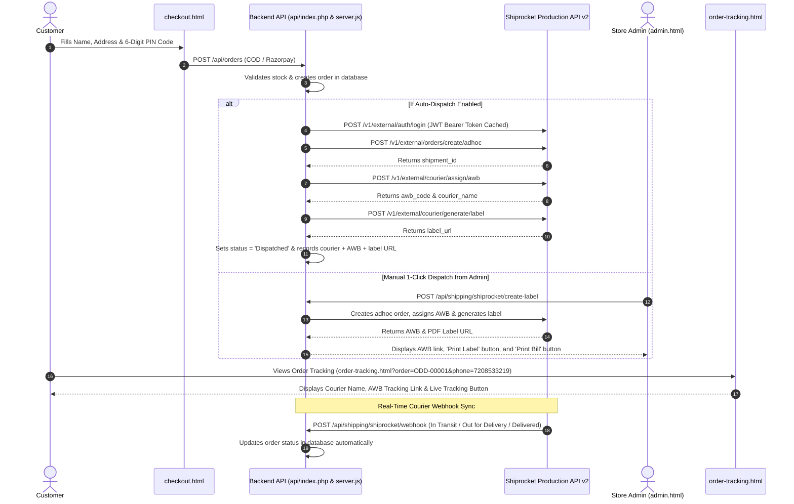

# ODD Perfumes — Shiprocket Multi-Carrier Shipping Production Integration Guide

This guide details the complete architecture, API contracts, automated webhooks, audit findings, and step-by-step production deployment instructions for Shiprocket Multi-Carrier Logistics (`apiv2.shiprocket.in`) integrated into ODD Perfumes (`test.oddperfume.com`).

---

## 1. Architecture & End-to-End Workflow

The integration follows the official Shiprocket API v2 E-Commerce Checkout & Fulfillment architecture:



---

## 2. API Endpoints Reference

All endpoints are implemented in both [api/index.php](file:///D:/AYAN/odd-perfume/api/index.php) (Hostinger PHP Production) and [server.js](file:///D:/AYAN/odd-perfume/server.js) (Node.js Development):

### 1. Test Connection & Authentication
- **Endpoint:** `POST /api/shipping/shiprocket/test`
- **Request Body:**
  ```json
  {
    "email": "oddperfumesocial@gmail.com",
    "password": "••••••••••••"
  }
  ```
- **Response (200 OK):**
  ```json
  {
    "success": true,
    "message": "Shiprocket connection verified! API authentication successful.",
    "account": {
      "id": 123456,
      "email": "oddperfumesocial@gmail.com",
      "name": "ODD Perfumes Admin"
    }
  }
  ```

### 2. Manual 1-Click Order Dispatch & Label Generation
- **Endpoint:** `POST /api/shipping/shiprocket/create-label`
- **Headers:** `X-CSRF-Token: <token>`, `Cookie: odd_session=...`
- **Request Body:**
  ```json
  {
    "orderId": "ODD-00001"
  }
  ```
- **Response (200 OK):**
  ```json
  {
    "success": true,
    "trackingNumber": "5353110028184",
    "tracking_number": "5353110028184",
    "labelUrl": "https://shiprocket-labels.s3.amazonaws.com/label.pdf",
    "label_url": "https://shiprocket-labels.s3.amazonaws.com/label.pdf",
    "trackUrl": "https://shiprocket.co/tracking/5353110028184",
    "tracking_url": "https://shiprocket.co/tracking/5353110028184",
    "carrier": "Delhivery Logistics",
    "courier_name": "Delhivery Logistics",
    "message": "Shiprocket label generated with Delhivery Logistics! AWB: 5353110028184"
  }
  ```

### 3. Courier Rate & Serviceability Calculation
- **Endpoint:** `POST /api/shipping/shiprocket/rates`
- **Request Body:**
  ```json
  {
    "postalCode": "400001",
    "isCod": true
  }
  ```
- **Response (200 OK):**
  ```json
  {
    "success": true,
    "count": 4,
    "rates": [
      {
        "carrier": "Delhivery Surface",
        "carrierName": "Delhivery Surface",
        "service": "standard",
        "serviceName": "Delhivery Surface (2-4 days)",
        "totalPrice": 65.0,
        "currency": "INR",
        "estimate": "2-4 days"
      }
    ]
  }
  ```

### 4. Live Tracking Status Webhook
- **Endpoint:** `POST /api/shipping/shiprocket/webhook`
- **Payload:** Shiprocket tracking payload containing `awb`, `current_status`, and `order_id`.
- **Response (200 OK):**
  ```json
  {
    "success": true,
    "matched": true,
    "orderId": "ODD-00001",
    "updatedStatus": "Delivered"
  }
  ```

### 5. Settings Configuration
- **Endpoints:**
  - `GET /api/settings/shiprocket` (Returns masked credentials)
  - `POST /api/settings/shiprocket` or `PUT /api/settings/shiprocket` (Saves settings)

---

## 3. Production Deployment Checklist for Hostinger

1. **Configure Environment Variables in Hostinger:**
   - In Hostinger hPanel -> Advanced -> Environment Variables or `.env`:
     ```env
     SHIPROCKET_EMAIL=oddperfumesocial@gmail.com
     SHIPROCKET_PASSWORD=Aoeo6$g4!7RYRLSLM0@V90MYX!fI*Gg!
     SHIPROCKET_PICKUP_LOCATION=Primary
     ```
2. **Create Dedicated API User in Shiprocket Dashboard:**
   - Log into Shiprocket Dashboard (`app.shiprocket.in`).
   - Navigate to Settings -> API -> Configure.
   - Click "Create an API User".
   - Enter your preferred email and password (e.g. `oddperfumesocial@gmail.com` and `Aoeo6$g4!7RYRLSLM0@V90MYX!fI*Gg!`).
   - Confirm permissions.
3. **Set Pickup Address in Shiprocket:**
   - In Shiprocket Dashboard -> Settings -> Pickup Addresses.
   - Ensure the pickup address name matches `SHIPROCKET_PICKUP_LOCATION` (default: `Primary`).
4. **Configure Webhook in Shiprocket:**
   - In Shiprocket Dashboard -> Settings -> API -> Webhooks.
   - Add webhook URL: `https://test.oddperfume.com/api/shipping/shiprocket/webhook`.
   - Select events: Order In-Transit, Out for Delivery, Delivered, RTO / Exception.
5. **Verify In Admin Panel:**
   - Visit `https://test.oddperfume.com/admin.html`.
   - Click "Shipping & Delivery" tab.
   - Verify Shiprocket Card shows "Active (Production)".
   - Click "Test Connection" to verify real-time authentication.
